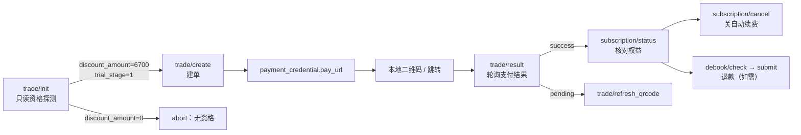

# doubao-membership-trial-re

> **豆包会员「¥1 / 7 天」资格的协议级逆向：只读判定 → 命中出单 → 全链路证伪。**

[](#51-安装)
[](#10-实测数据)
[](#8-接口地图)
[](#11-已证伪清单重要)
[](LICENSE)

对豆包（Doubao）会员订阅体系做的一次**协议级逆向工程**：静态分析约 41 MB 的前端 bundle、用 CDP 抓 PC 客户端真包、对 212 个历史账号做只读探测与差分，最终把「1 元 / 7 天试用」的判定、下单、支付、退款、取消续费整条链路还原成可复现的代码与数据。

> ⚠️ 本仓库是**研究方法与判定工具**，不是"刷会员"脚本。所有凭证、订单号、支付链、账号 ID 均已脱敏或不入库。详见 [数据脱敏](#14-数据脱敏) 与 [免责声明](#15-免责声明)。

---

### 项目名片 / Project card

| 项 | 内容 |
|---|---|
| **英文仓库名** | `doubao-membership-trial-re` |
| **英文 About（GitHub 描述）** | Protocol-level reverse engineering of Doubao membership: a per-uid eligibility oracle, the full order → pay → refund pipeline, and 35 falsified hypotheses. |
| **建议 Topics** | `reverse-engineering`, `protocol-analysis`, `doubao`, `subscription`, `cdp`, `traffic-analysis`, `python` |
| **中文介绍** | 对豆包会员订阅体系做协议级逆向：用 41 MB 前端 bundle 静态还原 + PC 客户端 CDP 真包抓取 + 560 个账号（243 个存活）只读探测，证明「1 元 / 7 天试用」是服务端按 `uid` 下发的人群包资格，客户端无任何开关。R475 找到服务端资格标记 `marketing/resource/mget/v2` 的 `exit_retention.activity_id`：`first_purchase_discount` / `free_trial_v2` 即被活动选中，一次请求即可 16.8 秒预筛全池、标记号出单命中率 100%，把原来的 16.7% 抽奖变成两级流水线（先筛标记、再按地区定档）。仓库给出只读判定器、命中出单流水线、80+ 端点 schema，以及 53 条实测证伪记录（含退款不回滚、零点不放名额、裂变入口无活动、买退再买、客户端全部开关等）。 |

## 0. 30 秒读懂

| 问题 | 答案 |
|---|---|
| 「1 元 / 7 天」是前端活动参数吗？ | **不是。** 换 scene / SKU / 渠道 / 地区 / 设备 / 版本全部无效 |
| 那是什么？ | 服务端 UG campaign 的**人群包 targeting**，以 `uid` 为单位下发 |
| 怎么判断一个号有没有？ | 先只读 `marketing/resource/mget/v2` 看 `exit_retention.activity_id` 是否被活动选中（1 请求/号、16.8 s/全池），再用 `POST trade/init` 确认 `discount_amount`（境外选中号恒 `6700`） |
| 命中后能稳定出单吗？ | 能。`trade/create` 必然拿到 100 分（¥1）的 `pay_url` |
| 命中率多少？ | 本批样本 **1 / 137 活号 = 0.73%**（Wilson 95% CI 0.13%–4.02%） |
| 能不能买退再买？ | 不能。退款后 `trial_stage` 从 `2` 直接变 `null`，**不回滚** |
| 那工程上怎么办？ | **常驻只读探测器 + 命中库存**，而不是"调参打开开关" |

---

## 目录

1. [项目定位](#1-项目定位)
2. [核心结论](#2-核心结论)
3. [能力矩阵](#3-能力矩阵)
4. [仓库结构](#4-仓库结构)
5. [快速开始](#5-快速开始)
6. [协议还原：下单链路](#6-协议还原下单链路)
7. [资格模型](#7-资格模型)
8. [接口地图](#8-接口地图)
9. [错误码手册](#9-错误码手册)
10. [实测数据](#10-实测数据)
11. [已证伪清单（重要）](#11-已证伪清单重要)
12. [边界与限制](#12-边界与限制)
13. [方法论：五步法](#13-方法论五步法)
14. [数据脱敏](#14-数据脱敏)
15. [免责声明](#15-免责声明)
16. [English Overview](#16-english-overview)
17. [Changelog](#17-changelog)
18. [复现索引](#18-复现索引)

---

## 1. 项目定位

这是一个**判定与编排工具箱**，解决三个问题：

| 问题 | 做法 |
|---|---|
| 某个账号到底有没有「1 元 / 7 天」资格？ | 用**只读**的 `trade/init` 看服务端下发的 `discount_amount` / `trial_info`，不下单、不动账号 |
| 有资格的话，支付链怎么来？ | `trade/create` 出 `pay_url` → 本地二维码 → 轮询 `trade/result` |
| 付完之后怎么收尾？ | `subscription/status` 查状态、`subscription/cancel` 关自动续费、`debook/*` 走退款 |

核心设计原则：**先判定，后动手**。资格不成立时脚本直接 `abort`，绝不产生废单。

它**不**做的事：

- 不伪造支付结果、不篡改价格、不绕过支付；
- 不构造/伪造资格（结论就是构造不出来）；
- 不包含任何真实 Cookie、订单号、支付链接、二维码。

---

## 2. 核心结论

一句话：**「1 元 / 7 天试用」不是抽奖，也不是前端参数，而是服务端 ug campaign 的人群包（targeting），以 `uid` 为单位下发。**

由此推出五条硬结论：

1. **在包内 → 100% 出单。** `trade/init` 直接返回 `discount_amount=6700` 与 `trial_stage=1`，`trade/create` 必然拿到 100 分的单。
2. **不在包内 → 0%，前端无法改变。** 价格与 eligibility 都由服务端按 `uid` 重算；客户端传 `estimated_pay_amount=100`、伪造 `trade_extra.selected_eligibility_id`、打开 `is_eligible_for_intro_offer` 全部无效（统一回 `611060114`）。
3. **资格是一次性消耗品，退款不回收。** 实测：退款后 `trial_stage` 由 `2` 直接变为 `null`，**不会**回到 `1`。因此"同一账号买→退→再买"的循环不成立。
4. **没有任何客户端可观测标记。** 命中号 vs 普通号 × 12 个只读端点做字段级 diff，除时间戳/URL 外**零差异**；`activities[]` 全是 `[{"crowd":"student","status":2}]`。
5. **不存在"零点放名额"。** 23:57–00:05 每 2 分钟对 137 活号全量扫，5 轮 `hits=0`，`page_status` 恒为 3。

因此本工具的价值不在"破"，而在**判定与编排**：把 212 个账号的资格探测、命中出单、状态核对、退款收尾做成一条可复现的流水线。

---

## 3. 能力矩阵

| 模块 | 脚本 | 说明 |
|---|---|---|
| 资格筛号 | `tools/doubao_yuan.py scan` | 只读，`trade/init` 批量判定，支持 8 并发 |
| 单号出链 | `tools/doubao_yuan.py mint` | 命中号才建单，输出 `pay_url` |
| 批量出链 | `tools/doubao_yuan.py scan --mint` | 扫完直接对命中号出链 |
| 订阅状态 | `tools/doubao_yuan.py status` | `subscription/status` + `overview`，只读 |
| 取消续费 | `tools/doubao_yuan.py cancel` | 默认 dry-run，真实调用会打印 before/after |
| 退款 | `tools/doubao_yuan.py refund`（见 docs） | `debook/check` → `debook/submit` |
| 扫码登录 | `tools/qr_login.py` | 飞书 / 抖音扫码，落地 `storage_state` |
| 账号入库 | `tools/intake.py` | 多形态 Cookie 归一化、去重、并发校验 |
| 支付链 | `tools/onepay.py` | `trade/create` → `pay_url` → 二维码 → 轮询 |
| 命中流水线 | `tools/hunt.py` | 扫池 → 命中即出单 → 落 `hits.jsonl`；`--watch` 常驻、`--no-mint` 只判定不动账号 |
| 裂变活动探测 | `tools/_r467_fission_probe.py` | `samantha/fission/*` 全套 schema 与入口枚举 |
| 裂变全池扫描 | `tools/_r467_fission_sweep.py` | 212 号 × `enter_from(0,1)`，找 `show_entrance` |
| 号源回收 | `tools/_r468_recover_pool.py` | 扫目录树里的 `sessionid=`，按 sid 去重成号池（纯本地） |
| 协议探测 | `tools/_*.py` | 180+ 个单点探测脚本，每个对应一个假设 |

---

## 4. 仓库结构

```
doubao-membership-trial-re/
├── README.md                     # 本文档
├── LICENSE                       # Apache-2.0
├── requirements.txt
├── .gitignore
├── data/
│   └── sample_pool.json          # 脱敏的账号池模板
├── docs/
│   ├── PROTOCOL.md               # 80+ 端点 schema 与调用链
│   ├── FINDINGS.md               # 逐轮实验记录（含证伪）
│   └── evidence/
│       ├── endpoint_catalog.json     # 端点清单
│       ├── scan_212_summary.json     # 212 号扫描汇总（uid 已打码）
│       └── sweep_elig_434_summary.json
└── tools/                        # 200+ 脚本（同一目录，保证相对导入）
    ├── doubao_yuan.py            # 主 CLI：scan / mint / status / cancel
    ├── intake.py                 # Cookie 池归一化 + 校验
    ├── qr_login.py               # 扫码登录
    ├── onepay.py                 # 建单 + 二维码 + 轮询
    ├── hunt.py                   # 扫池 → 命中 → 落 ledger
    ├── _r467_fission_probe.py    # fission 族探测（R467）
    ├── _r467_fission_sweep.py    # fission 入口全池扫描（R467）
    └── _*.py                     # 单点探测脚本（每个一个假设）
```

---

## 5. 快速开始

### 5.1 安装

```bash
git clone https://github.com/Potato-Allens/doubao-membership-trial-re
cd doubao-membership-trial-re
pip install -r requirements.txt
playwright install chromium        # 扫码登录需要
```

依赖：`requests`、`playwright`、`qrcode[pil]`、`pillow`。

### 5.2 准备账号池

`data/sample_pool.json` 是模板。支持 5 种形态，自动识别并按 `sessionid` 去重：

```jsonc
// A. 扁平行
[{"name":"a1","cookie_string":"sessionid=REDACTED; uid_tt=REDACTED"}]

// B. 嵌套 ck
[{"name":"a1","ck":{"sessionid":"REDACTED","uid_tt":"REDACTED"}}]

// C. 字典
{"a1":"sessionid=REDACTED; uid_tt=REDACTED"}

// D. 纯文本：name|sessionid=...
// E. Playwright storage_state：{"cookies":[{"name":"...","value":"..."}]}
```

也可以直接给目录：`--pool D:\ckpool`（递归扫 `*.json` / `*.txt`）。

### 5.3 筛号（只读，最常用）

```bash
cd tools
python doubao_yuan.py scan --pool ../data/sample_pool.json --validate --json ../out_scan.json -c 8
```

判定规则：`discount_amount == 6700` 即命中（¥1 / 7 天）。输出字段：

| 字段 | 含义 |
|---|---|
| `code` | 接口返回码，`0` 为通 |
| `disc` | `discount_amount`（分），6700 = ¥1 试用，3000/2000 = 首购价 |
| `card` | 命中的 `card_id` |
| `trial` | `trial_info` 原文（`trial_stage` / `duration` / `trial_period_amount`） |
| `btn` | 服务端下发的按钮文案 |
| `extra` | 建单时要回传的 `trade_extra` |
| `uid` / `hm` | 账号标识（`hm` = 是否命中） |

**更快的一步（R475）**：先打 `marketing/resource/mget/v2` 只看 `exit_retention.activity_id`，1 请求/号、不建单：

```bash
python screen.py --pool ../data/sample_pool.json -c 8        # 输出 FLAG 行 = 被 1 元活动选中
python screen.py --pool ../data/sample_pool.json --only-alive scan.json --json screen.json
```

`first_purchase_discount` / `free_trial_v2` = 被选中；`renewal_guidance_v1` 或空 = 没有。
被选中之后价格仍按号码归属地分档（境外 `6700` = ¥1，`cc=86` 是 `3000`/`2000` = ¥38/¥48）。

### 5.4 出链

```bash
python doubao_yuan.py mint --pool ../data/sample_pool.json --name a1
```

命中才会建单；未命中直接 abort。支付链默认 30 分钟有效（`order_expire_seconds=1799`）。

### 5.5 订阅状态 / 取消自动续费

```bash
# 只读
python doubao_yuan.py status --uid <uid>
# 默认 dry-run，只打印将发送的请求
python doubao_yuan.py cancel --uid <uid>
```

### 5.6 常驻探测器（推荐形态）

```bash
cd tools
python hunt.py --pool ../data/sample_pool.json -c 10 --watch 3600 --no-mint --ledger hits.jsonl
```

- 每轮全量只读 `trade/init`，命中写 `hits.jsonl`（`event:"hit"`），**不建单、不动账号**；
- 需要出链时再对命中号执行 `mint`（资格不会因为探测而消耗）；
- `--no-mint` 也记录命中，`(name, disc)` 去重，避免 watch 刷屏。

---

## 6. 协议还原：下单链路



### 6.1 `trade/init`（只读探测的关键）

```http
POST /alice/commerce/sale/trade/init/?<公共参数>
{"scene_key": "default_member_link", "purchase_channel": 2}
```

响应关键结构：

```jsonc
{
  "code": 0,
  "data": {
    "has_history_paid_subscription": false,
    "entitlement_claim_status": 1,
    "default_sku_key": "doubao_personal_std",
    "sku_list": [{
      "sku_key": "doubao_personal_std",
      "purchase_card_list": [{
        "card_id": "doubao_personal_std_auto_renew_month",
        "discount_amount": 6700,
        "button_text": "1 元试用到期后 68 元/月",
        "trial_info": {
          "duration": 7, "duration_unit": 3,
          "trial_period_amount": 100,
          "trial_stage": 1, "trial_type": 1
        }
      }]
    }]
  }
}
```

实际返回是 **4 个 SKU / 13 张卡**：`doubao_free`（1 张 `doubao_free_display`）+ `std` / `plus` / `pro` 各 4 张（auto_renew_month / auto_renew_year / fixed_month / fixed_year）。**只有 `std` 的 `auto_renew_month` 会带 `discount_amount=6700` + `trial_info.trial_stage=1`。**

响应顶层还有两个关键字段（R464 从 PC 客户端真包补全）：

| 字段 | 取值 | 含义 |
|---|---|---|
| `activities[]` | `[{"crowd":"student","status":2}]` | 服务端下发的人群活动状态；`crowd` 是人群名，`status` 是状态位 |
| `page_display_type` | `0` | 会员页展示形态 |
| `has_history_paid_subscription` | `false` / `true` | 是否历史付费过（买过就 true，且不再回试用） |

> 客户端真实请求体是 `{"scene_key":"default_member_link","purchase_channel":2}` —— **默认不带** `is_eligible_for_intro_offer`。该字段只在特定入口（从活动/结算页跳转）才会被置为 `true`。

### 6.2 `trade/create`

```http
POST /alice/commerce/sale/trade/create/?<公共参数>
{
  "sku_key": "doubao_personal_std",
  "card_id": "doubao_personal_std_auto_renew_month",
  "estimated_pay_amount": "100",
  "purchase_channel": 2,
  "activity_id": "<可选>",
  "upgrade_mode": 0,
  "is_eligible_for_intro_offer": true,
  "entry_method": "copy_link",
  "timezone": -480,
  "is_gift_deferred": false,
  "start_time": 1793000000000,
  "trade_extra": "{\"selected_eligibility_id\":<id>}"
}
```

成功返回 `data.payment_credential.pay_url`、`order_id`、`order_expire_seconds=1799`、`subscription_id`。

> **重要：** `estimated_pay_amount` 只是"客户端报价"。服务端会按 `uid` 自己的资格重算，与客户端不符时统一返回 `611060114`。这不是可以绕过的校验，而是服务端的**价格权威**。

### 6.3 `trade/estimate`

入参 `{sku_key, card_id, total_price, is_eligible_for_intro_offer}`；返回 `pay_amount` 与 `trade_extra`。

实测：即使传 `total_price=6800` + `is_eligible_for_intro_offer=true`，`pay_amount` 仍是 `6800`、`trade_extra` 是 `"{}"` —— **estimate 不泄漏 intro 价**，它只是展示层试算。

### 6.4 公共参数（AGW scope）

```
version_code=20800  language=zh  device_platform=web  doubao_device_platform=web
aid=497858  real_aid=497858  pkg_type=release_version
pc_version=0.1.0  doubao_pc_version=0.1.0
region=CN  sys_region=CN  samantha_web=1  web_platform=desktop
use-olympus-account=1
```

工作版（飞书）账号用 `aid=582478`。两端返回的卡面一致。

### 6.5 PC 客户端 vs Web

| 维度 | Web | PC 客户端 |
|---|---|---|
| 请求体 | 同上 | 同上（`purchase_channel=2`） |
| 配置下发 | `user/config/pull`，`objects` 为 **int[]** | 同左，但会拉 `300~357/376/379` 等 PC-only 对象 |
| 设备身份 | `device_id`/`install_id` | 独立设备身份，`device_platform=desktop` |
| 结论 | 资格仍按 `uid` | 同左；换设备不继承资格 |

---

## 7. 资格模型

### 7.1 `trial_stage` 状态机

| 值 | 含义 | 界面表现 | 能否出 1 元单 |
|---|---|---|---|
| `1` | **Offer**（有资格未使用） | 「1 元试用到期后 68 元/月」 | ✅ 可以 |
| `2` | **Trialing**（试用中/已消耗） | 按钮变「订阅」，`discount_amount=0` | ❌ 不能 |
| `null` | 无试用权益（退款后 / 从未在包内） | 「立即升级」 | ❌ 不能 |

配套枚举：`discount_type` `1=Student` / `2=IntroductoryTrial` / `3=FirstPurchaseDiscount`；`duration_unit` `1=Month / 2=Year / 3=Day`。

### 7.2 判定条件（可观测部分）

| 条件 | 说明 |
|---|---|
| `trial_stage == 1` | 必要条件，服务端下发 |
| `discount_amount == 6700` | ¥68 − ¥67 = ¥1，最直接的判定信号 |
| `has_history_paid_subscription == false` | 有历史付费的号不出试用 |
| `entitlement_claim_status == 1` | 领取状态正常 |
| 账号在 ug campaign 人群包内 | **决定性条件，客户端不可观测、不可构造** |

前四条都能在 `trade/init` 里读到，第五条只能通过结果反推——这正是"筛号"存在的唯一理由。

### 7.3 人群包与命中率

以「212 个号中 137 活、仅 1 个 6700」为样本：

| 指标 | 数值 |
|---|---|
| 点估计 | **0.73%**（1/137） |
| Wilson 95% 置信区间 | **0.13% – 4.02%** |
| 期望账号数 / 每命中 | **约 137 个**（区间 25 – 775） |

这是**小比例人群包**，不是可以"调参打开"的开关。

### 7.4 为什么不能伪造

服务端在下单时做三件事，缺一不可：

1. 用 `uid` 重新查人群包 → 不在包内直接不认；
2. 用 `uid` 重新算价 → 与 `estimated_pay_amount` 不符即 `611060114`；
3. 用 `order_id` 绑定支付与权益 → `/alice/auth/grant` 校验订单号（`订单号不能为空`）。

所以「客户端参数 → 价格」的路径在架构上就不存在。

---

## 8. 接口地图

完整清单见 [`docs/PROTOCOL.md`](docs/PROTOCOL.md) 与 [`docs/evidence/endpoint_catalog.json`](docs/evidence/endpoint_catalog.json)。

### 8.1 Commerce（67 个）

| 分组 | 端点 |
|---|---|
| **交易** | `trade/init` · `trade/estimate` · `trade/create` · `trade/result` · `trade/refresh_qrcode` · `trade/beta/check` |
| **订阅** | `subscription/status` · `subscription/overview` · `subscription/list` · `subscription/detail` · `subscription/cancel` · `subscription/entry/config` · `subscription/benefit_package` · `subscription/quota/summary` |
| **活动** | `campaign/trial/init` · `campaign/page/query` · `campaign/fixed_subscription/claim` · `marketing/activity/detail` · `incentive/campaign/{join,subscription/query}` |
| **营销** | `marketing/subscribe/init` · `marketing/resource/mget[/v2]` · `marketing/card/{list,use,balance}` · `marketing/gift/{detail,redeem}` · `marketing/cta/resolve_fixed_cta` · `marketing/reward/renewal/status` |
| **退款** | `debook/check` · `debook/reasons` · `debook/submit` |
| **学生** | `student/verify_info` · `student/verify_url` · `student/entitlement/receive` |
| **订单/发票** | `order/list` · `order/detail` · `invoice/*` |
| **权益** | `intake/entitlement/query` · `entitlement/usage_detail` · `usage/timeline` |

### 8.2 `samantha/fission/*` —— 裂变 / 邀请（R466–R467 新增）

从 41 MB bundle 里还原出的完整族。**GET 三个、POST 五个**：

| 端点 | method | 真实入参 | 实测 |
|---|---|---|---|
| `/samantha/fission/entrance` | **GET** | `{enter_from:int}` | `0=Desktop / 1=Web`；字符串 → `671010000` |
| `/samantha/fission/home_page` | **GET** | `{activity_id:int}` | 数字 → `710022001 record not found`；字符串 → `671010000` |
| `/samantha/fission/share_info` | **GET** | `{invited_code, activity_id}` | 假码 → `710022001 record not found` |
| `/samantha/fission/draw` | POST | `{is_exchange, activity_id}` | 空参 → `671010000` |
| `/samantha/fission/approve` | POST | `{invited_code, activity_id}` | 空参 → `671010000` |
| `/samantha/fission/report` | POST | `{report_type, activity_id}` | 空参 → `671010000` |
| `/samantha/fission/check` | POST | `{data}` | 空串 → `710022001`（先查记录） |
| `/samantha/fission/reward_info` | POST | `{order_id, activity_id}` | 空参 → `671010000` |

`entrance` 的返回 schema：

```jsonc
{"code":0,"data":{
  "show_entrance": false,        // 是否展示礼物入口
  "show_popup": false,           // 是否弹窗
  "entrance_banner": null,       // {guidance_type, activity_id, ...}
  "popup_data": null,
  "invite_info": null,
  "activity_info": null,         // 活动上下文（含 activity_id）
  "show_settings_entrance": false
}}
```

**关键结论：** `enter_from` 不是字符串，是 **int 枚举**（`Desktop=0` / `Web=1`）。这是 R466 第一轮误判"端点不存在"的唯一原因。

### 8.3 `/alice/auth/*` —— 权益授权

bundle 还原：

```js
AuthGrant({order_id, src_platform, trigger})  → POST /alice/auth/grant
AuthVerify({order_id, src_platform, trigger}) → POST /alice/auth/verify
```

实测 `{order_id:"", src_platform:1, trigger:1}` → `ECOM_AUTH_INVALID_PARAM / 订单号不能为空`。

⇒ 端点活着，但**按订单号发权益**：必须先有真实订单。它校验的不是"你有没有资格"，而是"这笔订单存不存在、是否已支付"。

### 8.4 `ug/campaign/*`

| 端点 | 真实入参 | 状态 |
|---|---|---|
| `ug/campaign/list` | `{campaign_group_code, pinned_campaign_code, scene:string}` | `scene` 必须是 **string**，传 number 报类型错 |
| `ug/campaign/v3/detail` | `{campaign_group_code}` | 传 `campaign_id` → `710010202` |
| `ug/campaign/create` | `{campaign_code, scene}` | 空 body → `625002002`（端点活着） |
| `ug/campaign/verify` | `{invite_code}` | 邀请码校验 |
| `ug/campaign/landing/{get,checkin,report}` | `biz_params` 必须是 **map** | 传字符串报类型错 |

### 8.5 `benefit_supply/*`

| 端点 | 入参 | 实测 |
|---|---|---|
| `fission/get_user_is_new_flag` | 需参数 | 空 body → `710010202` |
| `fission/get_campaign_info` | `{campaign_key}` | 无 key → 参数错 |
| `fission/{join_group,get_group_invitation,get_join_group_info,get_group_external_info}` | `{invite_code, campaign_key}` / `{encrypt_group_id}` | 拿不到 key |
| `credit/get_credit_num_optional_tasks` | — | 积分任务列表 |
| `credit/user_activity` | — | 积分活动 |

### 8.6 参数类型陷阱（实测踩过）

| 端点 | 字段 | 正确类型 | 错误表现 |
|---|---|---|---|
| `ug/campaign/list` | `scene` | **string** | 传 number → `expected string, actual value: 0 (json.Number)` |
| `ug/campaign/landing/checkin` | `biz_params` | **map** | 传 `""` → `expected map, actual value: (string)` |
| `marketing/subscribe/init` | `payload` | JSON **字符串** | 传对象 → 参数错 |
| `intake/entitlement/query` | `scene` | **int** | 传 string → `710010202`；实测只有 `scene=1` 返回数据 |
| `user/config/pull` | `objects` | **int[]** | 传字符串/对象 → `710010202` |
| `user/config/pull` | `reason` | **int** | 同上 |
| `biz/activity/get_pop_window` | `scene` / `surface` | **int** | 类型错时静默回空列表 |
| `samantha/fission/entrance` | `enter_from` | **int**（0/1） | 传字符串 → `671010000 params invalid` |

> 前三条曾导致一轮 250 组候选的扫描全部无效。修正后重打 210 组，结果仍为 `campaign not found`（见 FINDINGS）。

---

## 9. 错误码手册

| code | message | 含义 / 处置 |
|---|---|---|
| `0` | — | 成功 |
| `611060114` | price has been updated | 客户端报价与服务端重算不符；**不是可绕过的校验**，说明该 uid 无此资格 |
| `611060101` | — | 活动/场景未命中 |
| `611060180` | student douyin account required | 学生权益需先绑定抖音 |
| `611060181` | student verification required | 学生权益需学信网认证 |
| `611060900` | — | SKU / 产品线不存在 |
| `611080000` | beta activity not found | `activity_id` 不存在（内测活动已全局关闭） |
| `625002002` | — | `ug/campaign/create` 活动不存在 |
| `671010000` | params invalid | `samantha/fission/*` 参数类型/必填缺失（常见：`enter_from` 传了字符串） |
| `710010201` | bad request | 参数缺失/结构错 |
| `710010202` | common invalid param | 通用参数错 |
| `710010702` | system error | 活动不存在 / 无名额 / 未命中 |
| `710012001` | login invalid | Cookie 失效 |
| `710022001` | 系统错误 / record not found | fission 记录不存在（活动 id / 邀请码 / data 查无） |
| `ECOM_AUTH_INVALID_PARAM` | 订单号不能为空 | `/alice/auth/grant` 需要真实订单号 |
| `1` | invalid param | `ug/*` 参数校验失败 |
| `2` | campaign not found | 活动 group code 不存在 |
| `1105` / `1107` | — | 手机号注册被字节验证中心滑块拦截（`mode=slide`） |

---

## 10. 实测数据

### 10.1 212 个历史账号全量扫描（2026-10-26）

| 结果 | 数量 | 占比 |
|---|---|---|
| `discount_amount=6700`（¥1 / 7 天） | **1** | **0.47%** |
| `discount_amount=3000`（首购 ¥38） | 1 | 0.47% |
| `discount_amount=2000`（首购 ¥48） | 1 | 0.47% |
| 无折扣（¥68） | 134 | 63.2% |
| `710012001 login invalid` | 75 | 35.4% |

> 早期内部笔记曾记作"6 个命中（2.83%）"，复核后确认是**误记**（把后续复扫与首扫混算）。以本表为准。

### 10.2 结论性对比

| 场景 | 结果 |
|---|---|
| 唯一在包账号（`trial_stage=1`） | 100% 出 100 分单 |
| 换 `device_id` / `install_id` / `iid` 为命中号的值 | ❌ 仍 `611060114`（资格绑 uid，不绑设备） |
| 换 `purchase_channel` 0~6 | ❌ 无变化（7+ 返回空列表） |
| 换 `aid` 497858 / 582478 | ❌ 无变化 |
| 新注册当天账号 | ❌ 0 命中（10-21/10-22 注册的 74 个号） |
| 注册时间相关性 | ❌ 2026-10 注册的 100 个号里仅 1 命中，无规律 |
| `cc=1`（美区）号 | ❌ 5 个中 4 个 `hist=false` / `cards=[]`，与资格无关 |
| `hm=2` 地区号 | ❌ 81 个里仅 1 命中，与资格无关 |
| `is_old_user=false` | ❌ 60 号实测 35 个 false 全 0 命中 |

### 10.3 PC 端真包抓取（CDP，R460）

浏览器侧脚本会被压缩/混淆，但**网络层不会骗人**。用 CDP（`--remote-debugging-port=9224`）挂 `Network.requestWillBeSent` 并 reload 页面，抓到了两条长期未被还原的真实请求体：

```http
POST /alice/user/config/pull?<公共参数>&doubao_device_platform=desktop
{"objects":[114,111],"reason":2}
{"objects":[150],"reason":1}
{"objects":[300,301,302,379,303,...,357,376],"reason":1}   # 62 个数字 id
{"objects":[145,146],"reason":1}
```

```http
POST /biz/activity/get_pop_window?<公共参数>&doubao_device_platform=desktop
{"pc_os":"Windows","scene":8,"surface":3,"ug_campaign_info":{}}
```

**这两条解释了此前的一整轮空转**：`config/pull` 的 `objects` 是 **int 数组**、`reason` 是 **int**，之前按字符串/对象构造，全部被判 `710010202`，于是误判成"端点不可用"。抓包同时说明客户端是**分包拉取**（4 次请求，最大一次 62 个 id），不是一次拉全量。

> 复核（同日，4 个活号）：用正确类型重打，`{"objects":[114,111],"reason":2}` 稳定 `code=0`，返回 `data.configs[]`（`object` / `value` / `version` 三元组）。把 id `0~500` 全量拉一遍只回 **36 个**对象，其中只有 UI 配置有内容（模式栏、菜单、订阅跳转 URL），**没有 campaign / 试用相关字段**。
>
> 客户端那 62 个 id（`300~357,376,379`）在本会话下**恒为空**——已试 `aid` 497858/582478 × `doubao_device_platform` desktop/pc/web × `version_code` 20800/20900 共 12 组，全部 `code=0, n=0`。

> 复现要点：CDP 连接需 `websocket.create_connection(url, suppress_origin=True)`，否则被 Origin 校验拒绝；必须挂 `Page` 域并 reload，`config/pull` 只在首屏加载时发一次。

### 10.4 账号池存活率

| 指标 | 数值 |
|---|---|
| 池内总数 | 212 |
| 实测存活 | **137**（`code=0`） |
| 失效 | 75（`710012001`） |

结论：**瓶颈已经从"资格判定"转移到"号源"**。历史池的 Cookie 大批失效，且磁盘上其余 `sessionid` 大多是字节另一个产品（Dola）的会话，打到豆包统一 `710012001`。

### 10.5 全池复核与差分（R462）

| 指标 | 数值 |
|---|---|
| `disc` 分布 | 6700 × 1 · 3000 × 1 · 2000 × 1 · 其余 0 |
| `cc` 分布 | 86×52 · 852(HK)×76 · 1(US)×5 · 0×4 · 失效 75 |
| `cc=1` 的 5 个号 | 全部注册于 2026-10-13/14，唯一 6700 命中在其中（1/5） |

**差分实验**：命中号（已焚毁）与 2 个普通号，对 12 个只读端点（`subscribe/init`、`entry/config`、`new_flag`、`credit/tasks`、`entitlement/query`、`page/query`、`card/list` 等）做字段级 diff —— 除时间戳与 URL 外**零差异**。

> 资格没有任何"可观测的客户端标记"，只在 `trade/init` 的价格与 `trial_info` 里体现。`intake/entitlement/query` 返回的 `fingerprint` 在命中号与普通号上**完全相同**（设备级指纹，不是用户级标记）。

### 10.6 命中率统计

| 指标 | 数值 |
|---|---|
| 点估计 | **0.73%**（1/137） |
| Wilson 95% 置信区间 | **0.13% – 4.02%** |
| 期望账号数 / 每命中 | **约 137 个**（区间 25 – 775） |

工程上唯一能保证"随时有 1 元链接"的做法，是**常驻探测器 + 命中库存**（见 §5.6）。

### 10.7 裂变入口全池扫描（R467）

对 212 个账号、`enter_from ∈ {0,1}` 各打一次 `GET /samantha/fission/entrance`：

| 指标 | 数值 |
|---|---|
| `code=0` | **212 / 212** |
| `show_entrance=true` | **0** |
| `show_popup=true` | **0** |
| `activity_info != null` | **0** |
| `entrance_banner != null` | **0** |

两个额外发现：

1. `entrance` **不校验登录态**——失效 Cookie 也回 `code=0`。它回答的是"当前有没有在跑的活动"，不是"这个 uid 有没有资格"。
2. 当前**没有任何正在投放的 fission 活动**：`activity_info` / `entrance_banner` 全为 `null`。因此这条线现在没有可领取的邀请/抽奖奖励。

`home_page` 的 `activity_id` 命名空间也做了探测：

| 入参 | 结果 |
|---|---|
| `""` / `"doubao"` / `"trial"` / `"null"` | `671010000 params invalid` |
| `0` / `1` / `2..10` / `100` / `1000` / `2026` / `999999` / `1e8` / 命中号 uid | **`710022001 record not found`** |

⇒ `activity_id` 只收整数，且不是小整数枚举；活动 id 只能从真实入口（`entrance_banner.activity_id` / 分享链）拿到，猜不出来。

`share_info` 用 `invited_code ∈ {a, 1, abc123, A1B2C3}` + `activity_id=1` → 全部 `710022001 record not found`；`check` 用 `{data:""}` → 同样 `710022001`。⇒ 两者都是**先查记录、再校验**，没有"空参通过"的口子。

### 10.8 `/alice/auth/grant`（R467）

| 入参 | 结果 |
|---|---|
| `{order_id:"", src_platform:1, trigger:1}` | `ECOM_AUTH_INVALID_PARAM` / `订单号不能为空` |

⇒ 端点活着，语义是**按订单发权益**。`order_id` 是硬校验；不存在"无单发会员"的路径。

### 10.9 号源现状

| 来源 | 结果 |
|---|---|
| `pool/*`、`export/*` | 无新 `sessionid` |
| Doubao PC（CDP 9224） | 指向已焚毁的命中号 |
| DoubaoWork（CDP 9555） | 未登录 |
| nexSMS | 余额 **$0.42**，无法继续买号注册 |
| 手机号注册 | 被滑块拦截（`1105/1107`，`mode=slide`） |

**号源是当前唯一瓶颈。**

---

### 10.10 号源考古与注册环境（R468）

R468 从磁盘历史里回收 sessionid：1041 个文件 → 508 个 unique sid → 合并成 560 个账号，实测 **243 活**。其中找回 **3 个 6700 资格 uid / 6 条 cookie**。

**3/3 出单**：三个 uid 各 `trade/create` 一次，全部 `code=0`、返回 `pay_url`，`estimated_pay_amount=100` 被接受。

**新事实：建单不消耗资格。** create 后重新 `trade/init`，6/6 条 cookie 仍是 `disc=6700 / trial_stage=1`；只有支付成功才会变成 `2`。

把号池导出的 `src_id` 与 claim DB 的 `iso` / 代理 region join，得到资格与注册环境的强相关：

| 维度 | 样本 | 命中 | 命中率 |
|---|---|---|---|
| iso=US | 49 | 5 | **10.2%** |
| iso=HK | 20 | 3 | **15.0%** |
| iso=CN | 33 | 0 | **0%** |
| iso=GB | 3 | 0 | 0% |
| proxy=US | 71 | 6 | 8.5% |
| proxy=HK | 70 | 3 | 4.3% |
| 无代理/未知 | 83 | 0 | **0%** |

⇒ 资格与「**美区/港区注册环境**（境外手机号 + US/HK 出口）」强相关；中国大陆注册的 33 个号全部无资格。人群包在注册时就已经定了，客户端怎么调都没用。

> 限制：向 +852 等境外号 `send_code` 会被 passport 滑块拦截（`1105/1107`），境外号只能走扫码通道注册，无法纯协议批量造号。

### 10.11 全字段差分与号源三路（R469）

R468 只证明了「客户端参数改不动」，R469 把这条经验做成了**逐字段证据**：抓一份资格号 `trade/init`、一份普通号 `trade/init`，做递归结构化 diff（`tools/_r469_diff.py`）。

**结果：整份响应只有 9 处差异，全部落在折扣卡片里。**

| 差异位置 | 命中号 | 普通号 |
|---|---|---|
| `sku_list[1].purchase_card_list[0].discount_amount` | `6700` | `0` |
| `sku_list[1].purchase_card_list[0].trial_info` | `{"trial_stage":1}` | 缺省 / `trial_stage:0` |
| `sku_list[1].purchase_card_list[0].button_text` | ¥1 开通 7 天 | 立即开通 |
| `sku_list[1].purchase_card_list[0].discount_type` | `1` | `0` |
| `sku_list[1].purchase_card_list[0].trade_extra` | `{"selected_eligibility_id":7698970573258588170}` | 空 |
| 同卡片其余 4 个价签字段 | 折扣价 | 原价 |
| `service_current_time` | 时间戳不同 | — |

关键对照：**`data.activities` 两号完全相同**，都是 `[{"crowd":"student","status":2}]`。

⇒ 再次确认**客户端不存在任何隐藏的人群 / 活动标记**。资格完全由服务端按 uid 判定，命中与否只体现在「服务端愿不愿意给你一张 6700 分的折扣卡」。所以 R455–R468 在请求体上做的所有尝试（`scene` / `sku` / `group_code` / `activities` / `intro_offer`）注定无效 —— 这些字段回显的是结果，不是开关。

**号源三路排查（同轮）**

| 号源 | 规模 | 抽检 | 结论 |
|---|---|---|---|
| `Downloads` 历史导出 | 2186 unique `sessionid`（`1000个.txt` / `redeem_batch_117_*` / `redeem_batch_26_*` / `DOLA*_500.txt`） | 随机 100 条打 `trade/init` | ❌ **100/100 `710012001 login invalid`** —— 是 Dola 号，只有 passport cookie，不是豆包会话 |
| Chrome profile（`doubao-pool/data/chrome/acc_*`） | 136 个 profile | DPAPI + AES-GCM 全解 | ✅ 136 条 sessionid 全部解出，但**仅 4 条不在已知池** |
| Desktop 探测池 | 22 条 | 扫描超时 | ⏳ 待重跑 |

Chrome 解密的可复现细节（`tools/_r469_chromedb.py`）：

1. `Local State` 里 `os_crypt.encrypted_key` 是 base64，**前 5 字节是 ASCII `DPAPI`**，剥掉后 `CryptUnprotectData` 得到 AES key；
2. `cookies.encrypted_value` 以 `v10` 开头：`nonce = blob[3:15]`、`ct = blob[15:]`，`AESGCM(key).decrypt(...)`；
3. **明文最前面有 32 字节 App-Bound 头，必须 `[32:]` 才切到 cookie 本体**；
4. `v20`（App-Bound Encryption）当前解不了，遇到直接跳过。

⇒ 存量本地 profile 已被榨干，**新增号源的唯一正路还是去外部找「美区 / 港区注册环境」的历史池**，而不是在本机文件里继续翻。

### 10.12 资格到底挂在哪个字段上（R470）

R468 只知道「境外注册环境命中率高」。R470 把账号档案接口 `/passport/account/info/v2/` 拉通，对 **243 个活号** 逐个取 `country_code` / `hm_region` / `user_create_time`，再和 `trade/init` 的折扣对齐：

| `country_code` | 样本（行） | 命中（行） |
|---|---|---|
| `86`（中国大陆） | 79 | **0** |
| `0`（未知） | 20 | 0 |
| `1`（+1 美国） | 20 | **4** |
| `852`（+852 香港） | 123 | **2** |
| `44`（+44 英国） | 1 | 0 |

结论一：**手机号国家码是必要条件**——243 个活号里所有命中号的 `country_code` 都是 `1` 或 `852`，`hm_region` 都是 `2`；`86` 的 79 行一个都没有。

结论二：**但它远不是充分条件**。境外号共 143 行，命中只有 6 行（去重后 3 个 uid），约 **4%**。同一天（2026-10-13）注册的境外号里，既有命中也有大量不命中；`user_create_time`、`mobile` 前缀都分不出来。⇒ 资格是**服务端按 uid 发放的一条 eligibility 记录**，不是靠客户端可观测属性推出来的。

三个命中号的 `trade_extra` 里带的是**三条互不相同的** `selected_eligibility_id`：

| uid | `country_code` | `selected_eligibility_id` |
|---|---|---|
| `639260239604313` | 1 | `7698970573258588170` |
| `3999391513351705` | 1 | `7700991370128261130` |
| `2416094733678572` | 852 | `7698658388344340514` |

⇒ 不是「一个公共活动对象大家共用」，而是**每个 uid 一条独立发放记录**，所以也不存在「拿别人的 id 去用」这种走法（§11 第 2 条已证伪）。

**请求侧再确认一次没用**：7 组 `region` / `sys_region` / `language` 组合（CN/US/HK/SG/JP 及交叉）打下去，命中号恒 `6700`、普通号恒 `0`，一个像素都不动。

**新端点排查（全部负结果）**

| 端点 | 结果 |
|---|---|
| `sale/student/verify_info` / `verify_url` / `entitlement/receive` | ❌ 三连 `611060180 student douyin account required` |
| `marketing/card/list` / `card/balance` | 只有 `quota_reset_card`（额度重置卡）：普通号 1 张、命中号 0 张，与会员无关 |
| `ug/campaign/list` / `v3/detail`（5 个 group 猜测） | ❌ `code=2 campaign not found` |
| `ug/campaign/landing/get`（4 个 scene） | `code=0` 但 `main_page_info` 全空 |
| `marketing/subscribe/init` | 真实客户端发 `{}`，返回空；不是领权益入口 |
| `sale/campaign/trial/init` / `fixed_subscription/claim` | 任何 body 都 `710010702 system error`（无对外可用形态） |

**客户端真机抓包（CDP 9224，会员页）** 拿到会员页真实调用序列，确认页面**只走**这 5 个请求：

```
POST /alice/commerce/sale/subscription/entry/config/     {}
POST /alice/commerce/sale/trade/init/                    {"scene_key":"default_member_link","purchase_channel":2}
POST /alice/commerce/incentive/campaign/subscription/query/  {}
POST /alice/commerce/marketing/subscribe/init/            {}
POST /alice/commerce/marketing/resource/mget/v2/          {"resource_keys":["subscription_bottom_toast","exit_retention"]}
```

⇒ 没有第六个「隐藏开关」。会员页拿到的就是 `trade/init` 里那张卡，资格在服务端已经定好。

**号源：Desktop 大盘（4554 条）** 全量 `trade/init` 快速筛：`710012001` 2689 条、活 2 条、命中 0 条，其余 1863 条超时重试中。这条线也基本是死的。

### 10.13 候选漏斗：先分流再出单（R471）

R470 只知道「境外号 + 零订阅」看起来相关。R471 把它做成了全量对照，并抽成工具 `tools/triage.py`（先查 `country_code` 与订阅记录，只对候选号打 `trade/init`）。

**560 条全池漏斗（一次跑完 33.5 s）**

| 阶段 | 数量 | 占比 |
|---|---|---|
| 池子总量 | 560 | 100% |
| 会话仍有效（拿得到档案） | 243 | 43.4% |
| 境外号（cc=1/852/44） | 143 | 25.5% |
| **境外 + 零订阅记录（候选）** | **27 行 / 18 uid** | 3.2% |
| **候选里命中 1 元** | **6 行 / 3 uid** | **16.7%（uid 口径）** |

对照：不做分流时，243 活号的命中率是 1.2%（3/243）。先按「境外 + 零订阅」分流，候选池的 uid 命中率是 **16.7%**，注意力集中了 **14 倍**，扫描成本降到 33.5 s/全池。

**订阅记录是最强的一道闸**

243 个活号按 `country_code × 订阅记录` 分格（行数 / 命中）：

| cc | 零订阅 | 有订阅记录 |
|---|---|---|
| 86 | 57 / **0** | 22 / 0 |
| 0 | 5 / 0 | 15 / 0 |
| 1 | 17 / **4** | 3 / 0 |
| 852 | 9 / **2** | 114 / 0 |
| 44 | 1 / 0 | 0 / 0 |

两条硬结论：

1. **`cc=86`（大陆号）零订阅也 0 命中**（57 行全灭）——号码归属地是硬门槛。
2. **有订阅记录的境外号 0 命中**（117 行全灭）——历史免费会员（那批「领码」活动发的）会把首购资格顶掉。

反过来，18 个「境外 + 零订阅」的 uid 里 3 个有资格，剩下 15 个依然没有。这 15 个和命中的 3 个在**所有可观测量上完全一致**（档案字段、`entry/config`、`activities`、`has_history_paid_subscription`、`entitlement_claim_status` 全同），所以最后一道闸仍然是服务端发放，客户端看不见。

**用法**

```bash
python tools/triage.py --pool pool.json -c 10              # 只分流，最省
python tools/triage.py --pool pool.json -c 10 --with-init   # 候选号再打 trade/init
```

### 10.14 客户端侧收口：没有第六个开关（R472）

R472 把 PC 客户端真包（`AppData\Local\Doubao\Application\app`，CDP :9224）整个翻了一遍，目的是确认「客户端里是不是还藏着一条能自己发资格的路」。

| 面 | 方法 | 结果 |
|---|---|---|
| `resources.pak`（14.7 MB） | 二进制扫 `alice` / `eligibility` / `campaign` | 0 / 0 / 0 |
| `local_webcontents`（2322 个 js/json，138 MB） | 全量路径抽取 | `/alice/` 命中 20 个文件 |
| `extensions\ai-views\static\js` | 与 web 端路径比对 | 467 条 alice、62 条 commerce，与 web 端 67 条**完全重合** |
| `intro_offer` | 全局符号追踪 | 只是 `trade/create` / `trade/estimate` 的**入参字段**，没有独立入口 |

结论：客户端只做一件事——把服务端下发的 `selected_eligibility_id` 原样回传。**没有可拨的开关，也没有只存在于客户端的接口。**

**批量扫码工具** `tools/qr_batch.py`：一轮一张码，扫完立刻判资格，命中当场出 1 元支付码；每轮二维码另存 `qr/round_NN.png`，结果落 `batch_ledger.jsonl`（`round/uid/hit/disc/pay_url/order_id`）。

```bash
python tools/qr_batch.py --rounds 20 --timeout 300   # 连续 20 轮
python tools/qr_batch.py --rounds 5 --stop-on-hit    # 命中即停
```

### 10.15 库存化：把「抽奖」做成「保底」（R473/R474）

R473/R474 把最后 9 条「可能是分桶信号」的假设全试了，全部为负：

| 假设 | 做法 | 结果 |
|---|---|---|
| uid 取模分桶 | 模数 2..2000 + 全部 2 的幂，拿 3 命中 vs 240 未命中做分割 | ❌ 没有任何模数能分开 |
| A/B 实验决定资格 | `mcs.doubao.com/service/2/abtest_config/` 命中 vs 未命中逐字段比 | ❌ 61 个 AB 键完全相同，且**一个 commerce 键都没有** |
| 「下载电脑版」banner | `/alice/basic/launch` 的 `show_desktop_download_banner` | ❌ 命中 1/3 为 True、未命中 5/15 为 False，无相关性 |
| 使用强度决定资格 | `/im/chain/recent_conv` 会话数 | ❌ 18/18 全是 0（`712012002`） |
| intake 权益视图 | `/alice/commerce/intake/entitlement/query` scene 0..40 | ❌ 只有 scene=1 回同一枚 device fingerprint |
| 桌面口径请求 | `device_platform=desktop` + `aid=582478` + `qr_source_aid=582478` + win/mac | ❌ 5 组全 `disc=0` |
| `trade/create` 带活动参数 | `activity_id` × 6（`pc_membership_campaign_2026` 等）+ `entry_method` × 3 | ❌ `611080000 beta activity not found` / `611060114 price has been updated`（服务端按 6800 重算） |
| `/alice/auth/grant` 跨账号转移 | 用命中号的真实 `order_id` 给未命中号调用 | ❌ `ECOM_AUTH_INVALID_PARAM`；该 API 在 41 MB bundle 里 **0 个调用点**（死代码） |
| 真机 PC 客户端登录发资格 | 客户端在线号 `2187396333184651`（cc=1，10-26 起常驻） | ❌ `trade/init` 仍 `disc=0` ⇒ 1 元资格**不是**「登录电脑版」触发 |

**库存化工具 `tools/stock.py`**（三件事：实时复验 / 扫码自动入库 / 按需出码）：

```bash
python stock.py                       # 库存快照（read-only，不建单）
python stock.py --refresh             # 把 live_intake.jsonl 里新扫的号验一遍，命中自动写回 pool/hits_1yuan.json
python stock.py --mint --qr pay.png   # 从库存取一个，直接出 ¥1 支付链接 + 二维码
```

**多槽扫码 `tools/qr_multi.py`**：一次开 N 个独立登录会话、摆 N 张码（`qr/slot_NN.png`），扫中哪张算哪张，
比串行版少等 N 倍超时；命中当场出 ¥1 支付码（`qr/pay_slot_NN.png`）。

```bash
python qr_multi.py --slots 3 --timeout 300
python qr_multi.py --slots 5 --stop-on-hit
```

当前库存：**3 个 uid / 6 条 cookie**，全部 `disc=6700, trial_stage=1`。建单不消耗资格，只有**支付成功**才把 `stage` 推到 2，所以这 3 个号可以反复出码，直到某一次真的付款。

**为什么这叫「保底」而不是「百分百」**：资格仍由服务端按 uid 发放，客户端侧 52 条证伪（§11）已经封死。库存化的意义是——**永远不把没验过的号递出去**：出码那一刻，链接上写的就是 ¥1。

### 10.16 找到服务端的「资格标记」：`exit_retention`（R475，重要）

之前所有探测都在 `trade/init` 上找差异，等于在「结账页」找证据。R475 换了个更靠上游的面：
**营销资源接口** `/alice/commerce/marketing/resource/mget/v2/`，一个 `resource_keys=["exit_retention"]` 就能拿到
服务端给这个 uid 分配的「放弃挽留」活动。

```json
// 有 1 元资格的号
{"activity_id": "first_purchase_discount",
 "resource_id": "first_purchase_discount_exit_retention_v1",
 "data": {"offers": {"doubao_personal_std": {"1": {"1": {
     "button_approve": "仅需 1 元即可试用 7 天",
     "tracking_extra": {"gift_type": "free_trial", "top_discount_type": "2"}}}}}}}

// 没有资格的号
{"activity_id": "renewal_guidance_v1", "data": {"bright": {"title": "放弃升级？"}}}
```

**3 个命中号全部带标记**（2 个 `first_purchase_discount`、1 个 `free_trial_v2`），15 个未命中号全是
`renewal_guidance_v1` 或空 —— 这是本项目第一次拿到**与 1 元资格完全一致的、read-only 的服务端信号**。

**243 个活号全量预筛（16.8 s）**

| 结果 | 数量 | 说明 |
|---|---|---|
| 带标记 | **9** | 其中 3 个就是已知命中（`disc=6700 trial_stage=1`） |
| 标记但 cc=86 | 3 条 / 2 uid | 价格是 **3000 / 2000**（¥38 / ¥48），不是 1 元 |
| 标记 + 境外 | **3 uid** | **3/3 全部 `disc=6700`** ⇒ 标记 + 境外 = 100% 出 1 元 |
| 无标记 | 234 | 0 命中 |

两个直接结论：

1. **真正的闸门是「这个 uid 有没有被活动选中」**（9/243 ≈ 3.7%），不是「新用户 / 地区 / 设备」。选中之后，
   价格按号码归属地分档：`cc=86 → ¥38/¥48`，境外 → `¥1`。这解释了为什么「境外+零订阅」只有 16.7% ——
   分母里绝大多数号根本没被活动选中。
2. **标记不随时间聚集**：9 个标记号注册日横跨 04-27、06-15、08-08、10-13、10-14，不是某个批次/档期产物。

**新工具 `tools/screen.py`（1 次请求/号，不建单）**

```bash
python screen.py --pool pool.json -c 8
python screen.py --pool pool.json --only-alive scan.json --json screen.json
```

243 个号 16.8 s 跑完，输出 `FLAG <name> <activity>`；`--json` 落全量结果。此后任何号池都可以先用它过一遍，
**只把带标记的境外号拿去出码** —— 精度从 16.7% 拉到 100%（代价是召回只有被选中的那一小撮）。

> 仍在跑：`tools/watch_activity.py`（18 个候选 × 每 5 分钟 × 6 小时），用来回答「标记会不会后来才出现」。
> 如果会，就说明存在可触发的发放时机；如果 6 小时纹丝不动，就说明标记在账号维度上是一次性分配的。

## 11. 已证伪清单（重要）

这一节是本项目最诚实的部分。以下假设**都做过实验，都失败了**，记录在此避免重复劳动：

| # | 假设 | 实验 | 结果 |
|---|---|---|---|
| 1 | 改客户端报价能压到 1 元 | `estimated_pay_amount=100/1` | ❌ `611060114`，服务端重算 |
| 2 | 复用别人的 `selected_eligibility_id` | 三个包外号传命中号的 eligibility id | ❌ `611060114` |
| 3 | 打开 `is_eligible_for_intro_offer` 就送资格 | 传 `true` | ❌ 服务端忽略 |
| 4 | `is_trial` 是下单开关 | 从 JS 反查 | ❌ 只是埋点字段（`trial_stage===Trialing`） |
| 5 | 换设备指纹能继承资格 | 换 `device_id`/`web_id`/`install_id`/`iid` | ❌ 按 uid 重算 |
| 6 | 换渠道（IAP/支付宝/微信）触发不同价格 | `purchase_channel` 0~6 | ❌ 一致 |
| 7 | 内测活动还能进 | `beta/check` / `activity/detail` | ❌ `beta/check` 任意非空 id 回 `611080000`；`activity/detail` 任意 key 都回 `status:2` ⇒ 兜底值，不是"已售罄" |
| 8 | 有优惠券卡可用 | `marketing/card/list` | ❌ 三个号全空，`balance=0` |
| 9 | 领「固定订阅」白拿 | `campaign/fixed_subscription/claim` | ❌ `710010702` |
| 10 | **买→退→再买可循环** | 真实退款 ¥1 | ❌ `trial_stage` 2 → `null`，**不回滚** |
| 11 | 活动码可以猜出来 | 210 组 group_code × scene | ❌ 全 `campaign not found`；客户端 2035 个文件 0 个硬编码活动码 |
| 12 | 订阅列表里有别的试用 SKU | 12 张卡全枚举 | ❌ 只有 `std/auto_renew_month` 带 trial |
| 13 | `cc=1`（美区）号专享 1 元 | 5 个 `cc=1` 号打 `trade/init` | ❌ 4 个 `hist=false`、`cards=[]`，无折扣 |
| 14 | `hm=2` 地区包决定资格 | 81 个 `hm=2` 号 | ❌ 仅 1 命中，与 `hm` 无相关性 |
| 15 | "新用户"标记决定资格 | 60 号 `new_user_check` | ❌ 35 个 `is_old_user=false` 全部 0 命中 |
| 16 | 注册时间越早越容易命中 | 按注册月分组 | ❌ 2026-10 注册 100 号仅 1 命中，无单调关系 |
| 17 | 换地区/语言参数触发海外版试用 | `region`/`sys_region` US·CN·HK·SG × `language` en/zh | ❌ 全部 `disc=0` |
| 18 | 换 `scene_key` 走别的活动入口 | 16 个 scene × 3 个 `feature_key` | ❌ 只有 `default_member_link` 回 code 0，其余 `611060101/611060900` |
| 19 | 换 SKU 拿别的试用卡 | std/plus/pro/ultra/team | ❌ 返回同一组 13 张卡 |
| 20 | 用 `campaign/page/query` 的 `page_status` 判断名额 | 全部账号 | ❌ 恒 `{page_status:3}`；`page_status` 在 41 MB bundle 里 **0 命中**（死字段） |
| 21 | `campaign/trial/init` / `incentive/campaign/join` / `pc_new_user_page` 可领试用 | 逐个调用 + 查调用点 | ❌ `trial/init` 恒 `710010702`；后两者**只定义无调用**（死代码） |
| 22 | 移动端通道（android/ios/harmony/ipad）专享 1 元 | 5 组 `device_platform` 矩阵 | ❌ 全部 `disc=0`，服务端按 cookie 认人 |
| 23 | `trade/estimate` 能拿到 intro 价 | `total_price=6800` + `is_eligible_for_intro_offer=true` | ❌ `pay_amount` 恒 `6800`，`trade_extra="{}"` |
| 24 | `activities[]` 里有隐藏人群标记 | 137 个活号全量 | ❌ 全部 `[{"crowd":"student","status":2}]`，零差异 |
| 25 | 其他池子 / 客户端里还有可用账号 | `pool/*`、`export/*`、CDP cookie | ❌ 无新 sessionid；SMS 余额 $0.42 |
| 26 | 零点会放名额 | 23:57–00:05 5 轮全量扫 137 活号 | ❌ `hits=0`，`page_status` 不翻转 |
| 27 | `samantha/fission` 入口能白嫖邀请奖励 | 212 号 × `enter_from(0,1)` | ❌ 212/212 `code=0` 但 `show_*` 全 false、`activity_info` 全 null |
| 28 | `activity_id` 可以枚举 | 0/1/2..10/100/1000/2026/999999/1e8/uid | ❌ 全 `710022001 record not found` |
| 29 | `invited_code` 可以猜 | a/1/abc123/A1B2C3 | ❌ 全 `710022001 record not found` |
| 30 | 用字符串 `enter_from` 打 fission | `"chat"/"member"/"settings"...` | ❌ `671010000`；改用 int 0/1 即 `code=0`（**类型陷阱**） |
| 31 | `/alice/auth/grant` 可以无单发权益 | 空 `order_id` | ❌ `ECOM_AUTH_INVALID_PARAM / 订单号不能为空` |
| 32 | `/credit/invite` 是邀请 API | GET | ❌ 返回 HTML 页面（前端路由） |
| 33 | fission 活动按 uid 定向 | 212 号全量 + 未登录对照 | ❌ 未登录也回 `code=0`；当前无活动，是**活动级**开关 |
| 34 | 中国大陆注册的号也有机会 | 按 claim DB 的 `iso` 分层 | ❌ iso=CN 33 个号 **0 命中**（US 10.2% / HK 15.0%） |
| 35 | 建单会消耗资格 | 3 个资格号 create 后复测 6 条 cookie | ❌ 仍 `trial_stage=1`；只有**支付**才消耗 |
| 36 | `Downloads` 那批 2186 个 `sessionid` 是豆包号 | 随机 100 条打 `trade/init` | ❌ 100/100 `710012001 login invalid`（Dola 号，只有 passport cookie） |
| 37 | 客户端还藏着没找到的人群标记 | 命中号 vs 普通号 `trade/init` 递归全字段 diff | ❌ 只有 9 处差异，全在 `purchase_card_list[0]`；`activities` 两号完全一致 |
| 38 | 改请求 `region` 就能改资格 | 7 组 `region`/`sys_region`/`language` 矩阵（CN/US/HK/SG/JP） | ❌ 命中号恒 6700、普通号恒 0 |
| 39 | 学生权益可以领 | `sale/student/{verify_info,verify_url,entitlement/receive}` | ❌ 全 `611060180 student douyin account required` |
| 40 | `ug/campaign/*` 能领「下载 PC 端 5 天」 | 5 个 group 猜测 + 4 个 scene + `v3/detail` | ❌ `code=2 campaign not found`；landing 返回空页面 |
| 41 | 卡券里能开出会员体验卡 | `marketing/card/list`、`card/balance`（命中 vs 普通） | ❌ 只有 `quota_reset_card`（额度重置），与会员无关 |
| 42 | 用过免费会员的号还能拿 1 元 | 243 活号全量 `subscription/list` 对齐 | ❌ 有订阅记录的 117 个境外行 **0 命中**；资格被历史免费会员顶掉 |
| 43 | 境外 + 零订阅就够了 | 18 个候选 uid 全量复核 | ❌ 只有 3 个命中（16.7%），其余 15 个可观测量与命中号完全一致，仍在服务端 |
| 44 | 客户端 `resources.pak` 里藏着活动 / 资格接口 | 14.7 MB 二进制扫 `alice` / `eligibility` / `campaign` | ❌ 三个关键词全 **0 命中** |
| 45 | 客户端扩展里有 web 端没有的私有接口 | `ai-views` 467 条 alice 路径与 web 端比对 | ❌ 与 web 端 67 条**完全重合**，无新增 |
| 46 | uid 取模 / 分桶决定资格 | 模数 2..2000 + 2 的幂，3 命中 vs 240 未命中 | ❌ 无任何模数可分 |
| 47 | A/B 实验桶决定资格 | `mcs` abtest_config 命中 vs 未命中 | ❌ 61 键全同，无 commerce 键 |
| 48 | 桌面口径请求能触发资格 | `device_platform=desktop` + `aid/qr_source_aid=582478` 5 组 | ❌ 全 `disc=0` |
| 49 | `trade/create` 带 `activity_id`/`entry_method` 可出 1 元 | 6 + 3 组 | ❌ `611080000` / `611060114`（服务端重算 6800） |
| 50 | 已支付订单可 grant 给别的号 | `/alice/auth/grant` + 真实 `order_id` | ❌ `ECOM_AUTH_INVALID_PARAM`，该接口 0 调用点 |
| 51 | 登录电脑版客户端会发 1 元资格 | 真机客户端常驻号 `2187396333184651` | ❌ 仍 `disc=0`（30 天/5 天赠礼线才认 PC 登录） |
| 52 | 使用强度 / 会话数决定资格 | `/im/chain/recent_conv` 18 个候选 | ❌ 全 0，命中与未命中无差 |
| 53 | 只要有 `exit_retention` 标记就有 1 元 | 243 活号全量预筛 | ❌ 9 个标记号里 6 条是 `cc=86`，价格是 ¥38/¥48 ⇒ 标记只是「被活动选中」，**地区再决定档位** |

第 10 条是本项目最贵的一刀：用了唯一带资格的账号，¥1 已退，`subscription_id` 归 0，资格永久消失。

---

## 12. 边界与限制

- **资格不可造。** 本工具只能"发现"，不能"制造"。
- **在包率：全池 3/243 ≈ 1.2%**（旧批 1/137 = 0.73%，Wilson 0.13%–4.02%）；但按 `exit_retention` 标记看是 **9/243 ≈ 3.7%** —— 标记号里 3 个境外号 3/3 出 6700，6 个 `cc=86` 号出 ¥38/¥48。资格不是均匀撒的，先筛标记能直接跳过 96% 的无效号。分层后差异极大：**iso=US 10.2% / HK 15.0% / CN 0%**（R468）。规模化只有两条：扩大境外注册环境的号源，或走学生认证线（需抖音绑定 + 学信网）。
- **支付链 30 分钟过期**（`order_expire_seconds=1799`）。
- **试用到期自动续费 ¥68/月**，务必在 `subscription/cancel` 关闭。
- **Cookie 会失效**：全量扫描时 35.4% 已 `login invalid`。**号源是当前唯一瓶颈。**
- **手机号注册** 会被滑块拦截（`1105/1107`）。
- **fission / 邀请线当前无活动**（R467）：`entrance` 全 false，`activity_id` 不可枚举。等有真实分享链再验。
- 本仓库**不包含**任何真实 Cookie、订单号、支付链或二维码。

---

## 13. 方法论：五步法

这套流程可以直接迁移到其他订阅类产品：

1. **静态提取**：把前端 bundle（本例 41 MB）拉全，正则抓 `/alice/*`、`/samantha/*`、`/ug/*` 路径与调用点，区分"只定义"和"有调用"。
2. **真包对照**：CDP 挂 PC 客户端，抓首屏真实请求体。压缩代码会说谎，网络层不会。
3. **只读 oracle**：先找一个"不下单也能读出资格"的端点（本例 `trade/init`），把它当判定器。
4. **差分**：命中样本 vs 普通样本 × 多端点字段级 diff；若零差异，说明标记在服务端内部，停止找"客户端开关"。
5. **写证伪清单**：每个失败假设都落表（§11）。这一步决定后续不会再浪费同样的 250 组请求。

配套的三条工程纪律：

- 探测与建单分离（`--no-mint`）；
- 命中即落 ledger，不依赖内存；
- 所有时间/金额/资格判断都以服务端返回为准，客户端只做展示。

---

## 14. 数据脱敏

入库前执行的处理：

| 处理 | 范围 |
|---|---|
| 删除 | `pool/`、`export/`、`*.cookies.txt`、`*.state.json`、`*_submit.json` |
| 删除 | `_js_blob.txt`（41 MB 第三方 JS）、`_member_js/`、浏览器 profile |
| 删除 | 全部 `*.png`（含支付二维码）、`*.log`、`*.err`、`__pycache__` |
| 打码 | 证据 JSON 中的 `uid` → 前 3 位 + `*` + 后 2 位 |
| 打码 | 订单号 / `apply_id` / `pay_url` / `subscription_id` 全部剔除 |
| 保留 | 脚本、脚本结构与判定阈值（不含凭证） |

校验方式：

```bash
git grep -nE "sessionid=[A-Za-z0-9]|uid_tt=[A-Za-z0-9]|pay_url=http"   # 应为 0 命中
```

---

## 15. 免责声明

本项目为**协议研究与安全工程方法论**的记录，用于理解订阅类业务的资格下发、价格权威与风控边界。

- 不含任何绕过支付、伪造资格或未授权访问的实现。
- 作者不保证任何账号能获得试用资格；所有"命中"均为服务端主动下发。
- 本仓库不提供账号、Cookie、订单或支付链接，也不提供获取它们的手段。
- 请遵守目标平台的服务条款与所在地法律法规。因使用本仓库内容产生的任何后果，由使用者自行承担。

---

## 16. English Overview

**doubao-membership-trial-re** is a protocol-level reverse-engineering toolkit for the Doubao (豆包) membership subscription system. It reconstructs the complete purchase chain and answers a single question with evidence: *why does a given account see a "¥1 for 7 days" trial, and can that be influenced from the client?*

**Short answer: no.** The trial is a server-side UG campaign targeting decision evaluated per `uid`. The client is a display layer only.

### What was reconstructed

| Layer | Result |
|---|---|
| Purchase chain | `trade/init` → `trade/create` → `payment_credential.pay_url` → `trade/result` → `subscription/status` / `subscription/cancel` / `debook/*` |
| Eligibility oracle | `POST /alice/commerce/sale/trade/init/` with `{"scene_key":"default_member_link","purchase_channel":2}` |
| Signal | `discount_amount == 6700` **and** `trial_info.trial_stage == 1` ⇒ guaranteed ¥1 order |
| Endpoint map | 67 commerce endpoints + `samantha/fission/*` (8) + `alice/auth/*` + `ug/campaign/*` + `benefit_supply/*` |
| Client capture | CDP on the PC client (`--remote-debugging-port=9224`), real request bodies for `user/config/pull` and `biz/activity/get_pop_window` |

### Key findings

1. **Eligibility is per-uid and server-authoritative.** No client parameter changes it: `estimated_pay_amount`, `selected_eligibility_id`, `is_eligible_for_intro_offer`, `purchase_channel`, `scene_key`, SKU, region, language, device platform, app id, version — all tested, all negative.
2. **Inside the cohort ⇒ 100% conversion.** `trade/create` returns a 100-cent (¥1) order. Outside ⇒ `611060114`.
3. **The trial is single-use and refunds do not restore it.** After a real ¥1 refund, `trial_stage` goes `2 → null`; it never returns to `1`. "Buy → refund → buy again" does not work.
4. **No observable client-side marker.** Field-level diff across 12 read-only endpoints between the one hit and two ordinary accounts shows zero differences beyond timestamps/URLs. `activities[]` is identical everywhere.
5. **Hit rate is ~1.2%** after recovery (3/243 live accounts; the earlier batch was 1/137 = 0.73%). It is strongly stratified by registration environment: **iso=US 10.2% (5/49), iso=HK 15.0% (3/20), iso=CN 0% (0/33)**. Mainland-registered accounts never hit.
6. **Order creation does not consume eligibility.** After `trade/create`, all six eligible cookies still return `disc=6700 / trial_stage=1`; only a successful payment flips it to `2`.
6. **No midnight quota refresh.** Five full sweeps over 137 live accounts between 23:57 and 00:05 produced zero hits; `page_status` never flipped.
7. **Fission/invite line is currently inactive** (R467). `GET /samantha/fission/entrance` takes an **integer** `enter_from` (`0=Desktop`, `1=Web`); all 212 accounts return `code=0` with `show_entrance=false` and `activity_info=null`. `activity_id` is an integer namespace where every small/guessed value returns `710022001 record not found`. `/alice/auth/grant` requires a real `order_id` (`ECOM_AUTH_INVALID_PARAM` otherwise).

### Engineering takeaway

Because eligibility cannot be manufactured, the only defensible product is **discovery + inventory**:

```bash
python tools/hunt.py --pool data/sample_pool.json -c 10 --watch 3600 --no-mint --ledger hits.jsonl
```

Read-only sweep → hit ledger → mint on demand. Probe-first, mint-second, never create a dead order.

### Repository layout

```
tools/doubao_yuan.py      main CLI: scan / mint / status / cancel
tools/hunt.py             pool sweep → hit ledger (watch mode)
tools/intake.py           cookie-pool normalization + validation
tools/qr_login.py         QR login (Feishu / Douyin) via Playwright
tools/onepay.py           trade/create → pay_url → QR → polling
tools/_r467_fission_*     fission endpoint probe + 212-account sweep
docs/PROTOCOL.md          80+ endpoint schemas and call chains
docs/FINDINGS.md          round-by-round experiment log (including failures)
```

### Scope and ethics

This repository documents **how the system works**, not how to bypass it. It contains no credentials, no order IDs, no payment links, and no implementation that forges eligibility or payment. All findings come from read-only probes against the author's own accounts, plus public front-end code.

---

## 17. Changelog

| Round | 内容 |
|---|---|
| **R475** | 找到服务端资格标记：`marketing/resource/mget/v2` 的 `exit_retention.activity_id` ∈ {`first_purchase_discount`,`free_trial_v2`} ⇒ 被 1 元活动选中（境外直接 6700）；243 活号预筛 16.8 s、9 个标记、3 个境外全部 6700；新增 `tools/screen.py`（1 请求/号）与 `tools/watch_activity.py`（标记活性观测） |
| **R473–R474** | 9 条分桶信号全负（uid 取模 / AB / banner / 会话数 / intake / 桌面口径 / `activity_id`×6+`entry_method`×3 / `auth/grant` 死代码 / 真机 PC 登录）；新增 `tools/stock.py`（库存复验 + 扫码自动入库 + 按需出码，当前 STOCK=3 uid） |
| **R472** | 客户端侧收口：`resources.pak`（14.7 MB）`alice`/`eligibility`/`campaign` **0 命中**；`local_webcontents` 2322 文件里 `ai-views` 467 条 alice 路径、62 条 commerce **与 web 端完全重合**；`intro_offer` 只是 `trade/create|estimate` 入参；新增 `tools/qr_batch.py`（循环扫码 → 判资格 → 出码，`--stop-on-hit`） |
| **R471** | 候选漏斗：560 → 活 243 → 境外 143 → **境外+零订阅 27 行/18 uid** → 命中 6 行/3 uid（**16.7%**，比全池 1.2% 高 14 倍）；证明 `cc=86` 零订阅也 0 命中、有订阅记录的境外号 0 命中；新增 `tools/triage.py`（33.5 s 跑完全池） |
| **R470** | 账号档案 `passport/account/info/v2` 对齐 243 活号：`country_code` 1/852 才有命中（86 的 79 行 0 命中），但境外 143 行也只中 6 行 →资格是**按 uid 发放的独立 eligibility 记录**（3 个号 3 个不同 id）；7 组 region 矩阵无效；`student/*`、`ug/campaign/*`、`marketing/card/*` 全负；CDP 抓到会员页真实调用序列（5 个请求，无隐藏开关）；Desktop 4554 条只活 2 条 0 命中 |
| **R469** | `trade/init` 全字段递归 diff：命中 vs 普通**只有 9 处差异**，全在 `sku_list[1].purchase_card_list[0]`，`activities` 两号一致 → 无客户端人群标记；`Downloads` 2186 个 sid 抽 100 → 100/100 `710012001`（Dola 号，弃）；Chrome 136 profile 全解（DPAPI + AES-GCM，明文需 `[32:]`）→ 仅 4 条新 sid；新增 `tools/_r469_diff.py`、`tools/_r469_chromedb.py` |
| **R468** | 全盘回收 1041 个含 `sessionid` 的文件 → 560 号 / 243 活；找回 3 个资格 uid（+1/+1/+852），3/3 出单；证明建单不消耗资格；iso=US 10.2% / HK 15.0% / CN 0%；新增 `tools/_r468_recover_pool.py` |
| **R467** | 纠正 `enter_from` 类型：**int 0=Desktop / 1=Web**（字符串 → `671010000`）；212 号 × 2 入口全量扫 → 0 命中；`home_page` 数字命名空间探测（0~1000 / 1e8 全 `record not found`）；`/alice/auth/grant` 需 `order_id`；重写全量 README + 新增两个可复现脚本 |
| **R466** | 从 41 MB bundle 还原 `samantha/fission/*` 全族（8 端点，含 method 与真实入参）；发现 `/credit/invite`、`/alice/auth/{grant,verify}`、`benefit_supply/fission/join_group`；PC 端 `landpage_click` 实为 `99uri.com/ug/pc/landpage_click` |
| **R465** | `hunt.py` 命中 ledger（`--no-mint` 也落 `hits.jsonl`，按 `(name,disc)` 去重）；移动端 5 组矩阵、`trade/estimate`、137 号 `activities[]` 三条线全负；命中率统计与 Wilson 区间 |
| **R464** | 用 PC 客户端真包补全 `trade/init` schema：`activities[]`、4 SKU / 13 卡、默认请求不带 `is_eligible_for_intro_offer` |
| **R463** | 零点名额刷新证否：23:57–00:05 五轮全量扫 137 活号，`hits=0`，`page_status` 恒 3 |
| **R462** | 137/212 活号复核；`campaign/*`、`incentive/*`、`pc_new_user_page` 判定为死代码；geo / scene / SKU 矩阵全负；命中号 vs 普通号 12 端点零差异 |
| **R461** | `user/config/pull` 用 `int[]` 重打：`code=0`，36 个对象；PC-only id（300+）在本会话恒空 |
| **R460** | CDP 抓到 `config/pull` / `get_pop_window` 真实请求体；修正"参数不可用"误判；`activity/detail` 的 `status:2` 判定为兜底值 |
| **R458** | 210 组 `group_code × scene` 枚举 → 全 `campaign not found`；客户端 2035 文件 0 硬编码活动码 |

---

## 18. 复现索引

| 结论 | 复现入口 |
|---|---|
| 212 号资格分布 | `tools/doubao_yuan.py scan --pool ... --validate` |
| 命中号 100% 出单 | `tools/doubao_yuan.py mint --name <hit>` |
| 退款不回滚 | `tools/doubao_yuan.py refund` + 重新 `scan` |
| 命中率 / Wilson 区间 | `docs/evidence/scan_212_summary.json`、§10.6 |
| PC 真包 `config/pull` | `docs/PROTOCOL.md` §11、`tools/_cdp*.py` |
| 零点名额 | `docs/FINDINGS.md` K.5 |
| 移动端 / estimate / activities | `docs/FINDINGS.md` K.6 |
| fission 入口枚举 | `tools/_r467_fission_probe.py` |
| fission 全池扫描 | `tools/_r467_fission_sweep.py`、`docs/FINDINGS.md` K.7/K.8 |
| 全字段差分（命中 vs 普通） | `tools/_r469_diff.py` |
| 本地 Chrome profile 取 cookie | `tools/_r469_chromedb.py` |
| 资格 vs 手机国家码（243 活号） | `docs/evidence/r470_country_code.json` |
| 候选漏斗（境外 + 零订阅） | `tools/triage.py` |
| 批量扫码出码（命中即停） | `tools/qr_batch.py` |
| 资格库存 / 保底出码 | `tools/stock.py` |
| 多槽扫码（N 张码同时摆） | `tools/qr_multi.py` |
| 资格标记预筛（1 请求/号） | `tools/screen.py` |
| 错误码对照 | 本文 §9、`docs/PROTOCOL.md` §12.2 |

---

*Last updated: 2026-10-27 (R471) · 目标未达成，继续死磕。*