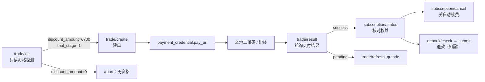

# doubao-membership-trial-re

> **只读探测，命中才出单** —— 把豆包「1 元 / 7 天试用」的资格判定做到可复现。

对豆包（Doubao）会员订阅体系做的协议级逆向工程与自动化工具集。通过静态分析约 41 MB 的前端 bundle、PC 客户端 CDP 抓包，以及 192 个脚本（含 186 个单点探测）的实测，完整还原了订阅下单链路与「1 元试用」的资格模型。

> ⚠️ 本仓库仅用于协议研究与方法论记录。所有凭证、订单号、支付链、账号 ID 均已脱敏或不入库。详见「数据脱敏」与「免责声明」。
>
> 📌 最近更新（R460）：用 CDP 抓到 `user/config/pull` 的真实请求体（`objects` 为 **int 数组**），修正了「参数不可用」的误判；同时把资格判别器的 4 个候选假设（`cc` / `hm` / 注册月份 / `is_old_user`）全部实测排除。

---

## 目录

1. [这是什么](#1-这是什么)
2. [核心结论](#2-核心结论)
3. [能力矩阵](#3-能力矩阵)
4. [目录结构](#4-目录结构)
5. [快速开始](#5-快速开始)
6. [协议还原：下单链路](#6-协议还原下单链路)
7. [资格模型](#7-资格模型)
8. [接口全集（67 个 commerce 端点）](#8-接口全集67-个-commerce-端点)
9. [错误码手册](#9-错误码手册)
10. [实测数据](#10-实测数据)
11. [已证伪清单](#11-已证伪清单重要)
12. [边界与限制](#12-边界与限制)
13. [数据脱敏](#13-数据脱敏)
14. [免责声明](#14-免责声明)
15. [English Overview](#15-english-overview)

---

## 1. 这是什么

一个**协议研究工具箱**，不是"刷会员"脚本。它解决三个问题：

| 问题 | 做法 |
|---|---|
| 某个账号到底有没有「1 元 / 7 天」资格？ | 用只读的 `trade/init` 看服务端下发的 `discount_amount` / `trial_info`，**不下单、不动账号** |
| 有资格的话，支付链怎么来？ | `trade/create` 出 `pay_url` → 转本地二维码 → 轮询 `trade/result` |
| 付完之后怎么收尾？ | `subscription/status` 查状态、`subscription/cancel` 关自动续费、`debook/*` 走退款 |

核心设计原则：**先判定，后动手**。资格不成立时脚本直接 `abort`，绝不产生废单。

---

## 2. 核心结论

一句话：**「1 元 / 7 天试用」不是抽奖，也不是前端参数，而是服务端 ug campaign 的人群包（targeting），以 `uid` 为单位下发。**

由此推出三条硬结论：

1. **在包内 → 100% 出单。** `trade/init` 直接返回 `discount_amount=6700` 与 `trial_stage=1`，`trade/create` 必然拿到 100 分的单。
2. **不在包内 → 0%，前端无法改变。** 价格与 eligibility 都由服务端按 `uid` 重算；客户端传 `estimated_pay_amount=100`、伪造 `trade_extra.selected_eligibility_id`、打开 `is_eligible_for_intro_offer` 全部无效（统一回 `611060114`）。
3. **资格是一次性消耗品，退款不回收。** 实测：退款后 `trial_stage` 由 `2` 直接变为 `null`，**不会**回到 `1`。因此"同一账号买→退→再买"的循环不成立。

因此本工具的价值不在"破"，而在**判定与编排**：把 212 个账号的资格探测、命中出单、状态核对、退款收尾做成一条可复现的流水线。

---

## 3. 能力矩阵

| 模块 | 脚本 | 说明 |
|---|---|---|
| 资格筛号 | `tools/doubao_yuan.py scan` | 只读，`trade/init` 批量判定，支持 8 并发 |
| 单号出链 | `tools/doubao_yuan.py mint` | 命中号才建单，输出 `pay_url` |
| 批量出链 | `tools/doubao_yuan.py scan --mint` | 扫完直接对命中号出链 |
| 订阅状态 | `tools/doubao_yuan.py status` | `subscription/status` + `overview`，只读 |
| 取消续费 | `tools/doubao_yuan.py cancel` | 默认 dry-run，真实调用会打印 before/after |
| 退款 | `tools/doubao_yuan.py refund`（见 docs） | `debook/check` → `debook/submit` |
| 扫码登录 | `tools/qr_login.py` | 飞书 / 抖音扫码，落地 `storage_state` |
| 账号入库 | `tools/intake.py` | 多形态 Cookie 归一化、去重、并发校验 |
| 支付链 | `tools/onepay.py` | `trade/create` → `pay_url` → 二维码 → 轮询 |
| 命中流水线 | `tools/hunt.py` | 扫池 → 命中即出单 → 落 `hits.jsonl`；`--watch` 常驻、`--no-mint` 只判定不动账号 |
| 协议探测 | `tools/_*.py` | 186 个单点探测脚本，每个对应一个假设 |

---

## 4. 目录结构

```
doubao-membership-trial-re/
├── README.md
├── LICENSE
├── requirements.txt
├── .gitignore
├── tools/                     # 192 个脚本（同一目录，保证相对导入）
│   ├── doubao_yuan.py         # 主 CLI：scan / mint / status / cancel
│   ├── intake.py              # Cookie 池归一化 + 校验
│   ├── qr_login.py            # 扫码登录
│   ├── onepay.py              # 建单 + 二维码 + 轮询
│   ├── hunt.py                # 扫池 → 命中即出单流水线
│   └── _*.py                  # 单点协议探测（见 docs/FINDINGS.md）
├── docs/
│   ├── PROTOCOL.md            # 接口全集 + 请求/响应 schema
│   ├── FINDINGS.md            # 实测证据 + 已证伪假设
│   └── evidence/
│       ├── scan_212_summary.json
│       ├── sweep_elig_434_summary.json
│       └── endpoint_catalog.json
└── data/
    └── sample_pool.json       # 脱敏的 pool 模板
```

---

## 5. 快速开始

### 5.1 安装

```bash
git clone https://github.com/Potato-Allens/doubao-membership-trial-re
cd doubao-membership-trial-re
pip install -r requirements.txt
playwright install chromium        # 扫码登录需要
```

### 5.2 准备账号池

`data/sample_pool.json` 是模板。支持 5 种形态，自动识别并按 `sessionid` 去重：

```jsonc
// A. 扁平行
[{"name":"a1","cookie_string":"sessionid=REDACTED; uid_tt=REDACTED"}]

// B. 嵌套 ck
[{"name":"a1","ck":{"sessionid":"REDACTED","uid_tt":"REDACTED"}}]

// C. 字典
{"a1":"sessionid=REDACTED; uid_tt=REDACTED"}

// D. 纯文本：name|sessionid=...
// E. Playwright storage_state：{"cookies":[{"name":"...","value":"..."}]}
```

也可以直接给目录：`--pool D:\ckpool`（递归扫 `*.json` / `*.txt`）。

### 5.3 筛号（只读，最常用）

```bash
cd tools
python doubao_yuan.py scan --pool ../data/sample_pool.json --validate --json ../out_scan.json -c 8
```

判定规则：`discount_amount == 6700` 即命中（¥1 / 7 天）。输出字段：

| 字段 | 含义 |
|---|---|
| `code` | 接口返回码，`0` 为通 |
| `disc` | `discount_amount`（分），6700 = ¥1 试用，3000/2000 = 首购价 |
| `card` | 命中的 `card_id` |
| `trial` | `trial_info` 原文（`trial_stage` / `duration` / `trial_period_amount`） |
| `btn` | 服务端下发的按钮文案 |
| `extra` | 建单时要回传的 `trade_extra` |
| `uid` / `hm` | 账号标识（`hm` = 是否命中） |

### 5.4 出链

```bash
python doubao_yuan.py mint --pool ../data/sample_pool.json --name a1
```

命中才会建单；未命中直接 abort。支付链默认 30 分钟有效（`order_expire_seconds=1799`）。

### 5.5 订阅状态 / 取消自动续费

```bash
# 只读
python doubao_yuan.py status --uid <uid>
# 默认 dry-run，只打印将发送的请求
python doubao_yuan.py cancel --uid <uid>
```

---

## 6. 协议还原：下单链路



### 6.1 `trade/init`（只读探测的关键）

```http
POST /alice/commerce/sale/trade/init/?<公共参数>
{"scene_key": "default_member_link"}
```

响应关键结构：

```jsonc
{
  "code": 0,
  "data": {
    "has_history_paid_subscription": false,
    "entitlement_claim_status": 1,
    "default_sku_key": "doubao_personal_std",
    "sku_list": [{
      "sku_key": "doubao_personal_std",
      "purchase_card_list": [{
        "card_id": "doubao_personal_std_auto_renew_month",
        "discount_amount": 6700,
        "button_text": "1 元试用到期后 68 元/月",
        "trial_info": {
          "duration": 7, "duration_unit": 3,
          "trial_period_amount": 100,
          "trial_stage": 1, "trial_type": 1
        }
      }]
    }]
  }
}
```

`std` / `plus` / `pro` 三个 SKU，各 4 张卡（auto_renew_month / auto_renew_year / fixed_month / fixed_year），共 12 张。**只有 `std` 的 `auto_renew_month` 会带 `discount_amount=6700`。**

### 6.2 `trade/create`

```http
POST /alice/commerce/sale/trade/create/?<公共参数>
{
  "sku_key": "doubao_personal_std",
  "card_id": "doubao_personal_std_auto_renew_month",
  "estimated_pay_amount": "100",
  "purchase_channel": 2,
  "activity_id": "<可选>",
  "upgrade_mode": 0,
  "is_eligible_for_intro_offer": true,
  "entry_method": "copy_link",
  "timezone": -480,
  "is_gift_deferred": false,
  "start_time": 1793000000000,
  "trade_extra": "{\"selected_eligibility_id\":<id>}"
}
```

成功返回 `data.payment_credential.pay_url` + `order_id` + `subscription_id`。

> **重要：** `estimated_pay_amount` 只是"客户端报价"。服务端会按 `uid` 自己的资格重算，与客户端不符时统一返回 `611060114`。这不是可以绕过的校验，而是服务端的**价格权威**。

### 6.3 公共参数（AGW scope）

```
version_code=20800  language=zh  device_platform=web  doubao_device_platform=web
aid=497858  real_aid=497858  pkg_type=release_version
pc_version=0.1.0  doubao_pc_version=0.1.0
region=CN  sys_region=CN  samantha_web=1  web_platform=desktop
use-olympus-account=1
```

工作版（飞书）账号用 `aid=582478`。两端返回的卡面一致。

---

## 7. 资格模型

### 7.1 `trial_stage` 状态机

| 值 | 含义 | 界面表现 | 能否出 1 元单 |
|---|---|---|---|
| `1` | **Offer**（有资格未使用） | 「1 元试用到期后 68 元/月」 | ✅ 可以 |
| `2` | **Trialing**（试用中/已消耗） | 按钮变「订阅」，`discount_amount=0` | ❌ 不能 |
| `null` | 无试用权益（退款后 / 从未在包内） | 「立即升级」 | ❌ 不能 |

配套枚举：`discount_type` `1=Student` / `2=IntroductoryTrial` / `3=FirstPurchaseDiscount`；`duration_unit` `1=Month / 2=Year / 3=Day`。

### 7.2 判定条件（可观测部分）

| 条件 | 说明 |
|---|---|
| `trial_stage == 1` | 必要条件，服务端下发 |
| `discount_amount == 6700` | ¥68 − ¥67 = ¥1，最直接的判定信号 |
| `has_history_paid_subscription == false` | 有历史付费的号不出试用 |
| `entitlement_claim_status == 1` | 领取状态正常 |
| 账号在 ug campaign 人群包内 | **决定性条件，客户端不可观测、不可构造** |

前四条都能在 `trade/init` 里读到，第五条只能通过结果反推——这正是"筛号"存在的唯一理由。

---

## 8. 接口全集（67 个 commerce 端点）

完整清单见 [`docs/evidence/endpoint_catalog.json`](docs/evidence/endpoint_catalog.json)，分组摘录：

| 分组 | 端点 |
|---|---|
| **交易** | `trade/init` · `trade/estimate` · `trade/create` · `trade/result` · `trade/refresh_qrcode` · `trade/beta/check` |
| **订阅** | `subscription/status` · `subscription/overview` · `subscription/list` · `subscription/detail` · `subscription/cancel` · `subscription/entry/config` · `subscription/benefit_package` · `subscription/quota/summary` |
| **活动** | `campaign/trial/init` · `campaign/page/query` · `campaign/fixed_subscription/claim` · `marketing/activity/detail` · `incentive/campaign/{join,subscription/query}` |
| **营销** | `marketing/subscribe/init` · `marketing/resource/mget[/v2]` · `marketing/card/{list,use,balance}` · `marketing/gift/{detail,redeem}` · `marketing/cta/resolve_fixed_cta` · `marketing/reward/renewal/status` |
| **退款** | `debook/check` · `debook/reasons` · `debook/submit` |
| **学生** | `student/verify_info` · `student/verify_url` · `student/entitlement/receive` |
| **订单/发票** | `order/list` · `order/detail` · `invoice/*` |
| **权益** | `intake/entitlement/query` · `entitlement/usage_detail` · `usage/timeline` |
| **UG 活动** | `ug/campaign/list` · `ug/campaign/v3/detail` · `ug/campaign/landing/{get,checkin,report}` · `ug/campaign/item/reward/claim` · `ug/campaign/verify` · `ug/campaign/student/*` |
| **配置下发** | `user/config/pull` · `biz/activity/get_pop_window` |
| **权益供给** | `benefit_supply/ping` · `benefit_supply/fission/get_user_is_new_flag` · `benefit_supply/fission/get_campaign_info` · `benefit_supply/credit/get_credit_num_optional_tasks` · `benefit_supply/credit/user_activity` · `benefit_supply/credit/get_credit_tip` |

### 8.1 参数类型陷阱（实测踩过）

| 端点 | 字段 | 正确类型 | 错误表现 |
|---|---|---|---|
| `ug/campaign/list` | `scene` | **string** | 传 number → `expected string, actual value: 0 (json.Number)` |
| `ug/campaign/landing/checkin` | `biz_params` | **map** | 传 `""` → `expected map, actual value: (string)` |
| `marketing/subscribe/init` | `payload` | JSON **字符串** | 传对象 → 参数错 |
| `intake/entitlement/query` | `scene` | **int** | 传 string → `710010202`；实测只有 `scene=1` 返回数据 |
| `user/config/pull` | `objects` | **int[]** | 传字符串/对象 → `710010202` |
| `user/config/pull` | `reason` | **int** | 同上 |
| `biz/activity/get_pop_window` | `scene` / `surface` | **int** | 类型错时静默回空列表 |

> 这三条曾导致一轮 250 组候选的扫描全部无效。修正后重打 210 组，结果仍为 `campaign not found`（见 FINDINGS）。

---

## 9. 错误码手册

| code | message | 含义 / 处置 |
|---|---|---|
| `0` | — | 成功 |
| `611060114` | price has been updated | 客户端报价与服务端重算不符；**不是可绕过的校验**，说明该 uid 无此资格 |
| `611080000` | beta activity not found | `activity_id` 不存在（内测活动已全局关闭） |
| `611060180` | student douyin account required | 学生权益需先绑定抖音 |
| `611060181` | student verification required | 学生权益需学信网认证 |
| `710010201` | bad request | 参数缺失/结构错 |
| `710010202` | common invalid param | 通用参数错 |
| `710010702` | system error | 活动不存在 / 无名额 / 未命中 |
| `710012001` | login invalid | Cookie 失效 |
| `1` | invalid param | `ug/*` 参数校验失败 |
| `2` | campaign not found | 活动 group code 不存在 |
| `1105` / `1107` | — | 手机号注册被字节验证中心滑块拦截（`mode=slide`） |

---

## 10. 实测数据

### 10.1 212 个历史账号全量扫描（2026-10-26）

| 结果 | 数量 | 占比 |
|---|---|---|
| `discount_amount=6700`（¥1 / 7 天） | **1** | **0.47%** |
| `discount_amount=3000`（首购 ¥38） | 1 | 0.47% |
| `discount_amount=2000`（首购 ¥48） | 1 | 0.47% |
| 无折扣（¥68） | 134 | 63.2% |
| `710012001 login invalid` | 75 | 35.4% |

> 早期内部笔记曾记作"6 个命中（2.83%）"，复核后确认是**误记**（把后续复扫与首扫混算）。以本表为准。

### 10.2 结论性对比

| 场景 | 结果 |
|---|---|
| 唯一在包账号（`trial_stage=1`） | 100% 出 100 分单 |
| 换 `device_id` / `install_id` / `iid` 为命中号的值 | ❌ 仍 `611060114`（资格绑 uid，不绑设备） |
| 换 `purchase_channel` 0~6 | ❌ 无变化（7+ 返回空列表） |
| 换 `aid` 497858 / 582478 | ❌ 无变化 |
| 新注册当天账号 | ❌ 0 命中（10-21/10-22 注册的 74 个号） |
| 注册时间相关性 | ❌ 2026-10 注册的 100 个号里仅 1 命中，无规律 |
| `cc=1`（美区）号 | ❌ 5 个中 4 个 `hist=false` / `cards=[]`，与资格无关 |
| `hm=2` 地区号 | ❌ 81 个里仅 1 命中，与资格无关 |
| `is_old_user=false` | ❌ 60 号实测 35 个 false 全 0 命中 |

### 10.3 PC 端真包抓取（CDP，R460）

浏览器侧脚本会被压缩/混淆，但**网络层不会骗人**。用 CDP（`--remote-debugging-port=9224`）挂 `Network.requestWillBeSent` 并 reload 页面，抓到了两条长期未被还原的真实请求体：

```http
POST /alice/user/config/pull?<公共参数>&doubao_device_platform=desktop
{"objects":[114,111],"reason":2}
{"objects":[150],"reason":1}
{"objects":[300,301,302,379,303,...,357,376],"reason":1}   # 62 个数字 id
{"objects":[145,146],"reason":1}
```

```http
POST /biz/activity/get_pop_window?<公共参数>&doubao_device_platform=desktop
{"pc_os":"Windows","scene":8,"surface":3,"ug_campaign_info":{}}
```

**这两条解释了此前的一整轮空转**：`config/pull` 的 `objects` 是 **int 数组**、`reason` 是 **int**，之前按字符串/对象构造，全部被判 `710010202`，于是误判成"端点不可用"。抓包同时说明客户端是**分包拉取**（4 次请求，最大一次 62 个 id），不是一次拉全量。

> 复现要点：CDP 连接需 `websocket.create_connection(url, suppress_origin=True)`，否则被 Origin 校验拒绝；必须挂 `Page` 域并 reload，`config/pull` 只在首屏加载时发一次。

### 10.4 账号池存活率（R460 复核）

| 指标 | 数值 |
|---|---|
| 池内总数 | 212 |
| 抽样前 40 个 | 11 存活 / 29 `710012001 login invalid` |
| 11 个活号的 `trial_hits` | **0** |

结论：**瓶颈已经从"资格判定"转移到"号源"**。历史池的 Cookie 大批失效，且磁盘上其余 `sessionid` 大多是字节另一个产品（Dola）的会话，打到豆包统一 `710012001`。

---

## 11. 已证伪清单（重要）

这一节是本项目最诚实的部分。以下假设**都做过实验，都失败了**，记录在此避免重复劳动：

| # | 假设 | 实验 | 结果 |
|---|---|---|---|
| 1 | 改客户端报价能压到 1 元 | `estimated_pay_amount=100/1` | ❌ `611060114`，服务端重算 |
| 2 | 复用别人的 `selected_eligibility_id` | 三个包外号传命中号的 eligibility id | ❌ `611060114` |
| 3 | 打开 `is_eligible_for_intro_offer` 就送资格 | 传 `true` | ❌ 服务端忽略 |
| 4 | `is_trial` 是下单开关 | 从 JS 反查 | ❌ 只是埋点字段（`trial_stage===Trialing`） |
| 5 | 换设备指纹能继承资格 | 换 `device_id`/`web_id`/`install_id`/`iid` | ❌ 按 uid 重算 |
| 6 | 换渠道（IAP/支付宝/微信）触发不同价格 | `purchase_channel` 0~6 | ❌ 一致 |
| 7 | 内测活动还能进 | `beta/check` / `activity/detail` | ❌ `beta/check` 任意非空 id 回 `611080000`；`activity/detail` **任意** key（含 `zzzzzzzz`）都回 `status:2` ⇒ `status:2` 是兜底返回值，**不是「已售罄」**（R460 修正） |
| 8 | 有优惠券卡可用 | `marketing/card/list` | ❌ 三个号全空，`balance=0` |
| 9 | 领「固定订阅」白拿 | `campaign/fixed_subscription/claim` | ❌ `710010702` |
| 10 | **买→退→再买可循环** | 真实退款 ¥1 | ❌ `trial_stage` 2 → `null`，**不回滚** |
| 11 | 活动码可以猜出来 | 210 组 group_code × scene | ❌ 全 `campaign not found`；客户端 2035 个文件 0 个硬编码活动码 |
| 12 | 订阅列表里有别的试用 SKU | 12 张卡全枚举 | ❌ 只有 `std/auto_renew_month` 带 trial |
| 13 | `cc=1`（美区）号专享 1 元 | 5 个 `cc=1` 号打 `trade/init` | ❌ 4 个 `hist=false`、`cards=[]`，无折扣 |
| 14 | `hm=2` 地区包决定资格 | 81 个 `hm=2` 号 | ❌ 仅 1 命中，与 `hm` 无相关性 |
| 15 | "新用户"标记决定资格 | 60 号 `new_user_check` | ❌ 35 个 `is_old_user=false` 全部 0 命中 |
| 16 | 注册时间越早越容易命中 | 按注册月分组 | ❌ 2026-10 注册 100 号仅 1 命中，无单调关系 |

第 10 条是本轮最贵的一刀：用了唯一带资格的账号，¥1 已退，`subscription_id` 归 0，资格永久消失。

---

## 12. 边界与限制

- **资格不可造。** 本工具只能"发现"，不能"制造"。
- **在包率约 0.47%**（本批样本）。规模化只有两条：扩大账号样本，或走学生认证线（需抖音绑定 + 学信网）。
- **支付链 30 分钟过期**（`order_expire_seconds=1799`）。
- **试用到期自动续费 ¥68/月**，务必在 `subscription/cancel` 关闭。
- **Cookie 会失效**：全量扫描时 35.4% 已 `login invalid`；R460 抽样前 40 个更是 29/40 失效，活号命中 0。**号源是当前唯一瓶颈。**
- **手机号注册** 会被滑块拦截（`1105/1107`）。
- 本仓库**不包含**任何真实 Cookie、订单号、支付链或二维码。

---

## 13. 数据脱敏

入库前执行的处理：

| 处理 | 范围 |
|---|---|
| 删除 | `pool/`、`export/`、`*.cookies.txt`、`*.state.json`、`*_submit.json` |
| 删除 | `_js_blob.txt`（41 MB 第三方 JS）、`_member_js/`、浏览器 profile |
| 删除 | 全部 `*.png`（含支付二维码）、`*.log`、`*.err`、`__pycache__` |
| 打码 | 证据 JSON 中的 `uid` → 前 3 位 + `*` + 后 2 位 |
| 打码 | 订单号 / `apply_id` / `pay_url` / `subscription_id` 全部剔除 |
| 保留 | 192 个脚本、脚本结构与判定阈值（不含凭证） |

校验方式：`git grep -nE "sessionid=[A-Za-z0-9]|uid_tt=[A-Za-z0-9]|pay_url=http"` 应为 0 命中。

---

## 14. 免责声明

本项目为**协议研究与安全工程方法论**的记录，用于理解订阅类业务的资格下发、价格权威与风控边界。

- 不含任何绕过支付、伪造资格或未授权访问的实现。
- 作者不保证任何账号能获得试用资格；所有"命中"均为服务端主动下发。
- 请遵守目标平台的服务条款与所在地法律法规。因使用本仓库内容产生的任何后果，由使用者自行承担。

---

## 15. English Overview

**Doubao Membership Trial RE** is a protocol-level reverse-engineering toolkit for the Doubao subscription system.

It reconstructs the full purchase chain — `trade/init` (read-only eligibility probe) → `trade/create` (order + pay URL) → `trade/result` (payment polling) — plus 67 related commerce endpoints covering campaigns, coupons, refunds, student benefits and auto-renewal.

**Key finding:** the "¥1 for 7 days" trial is not a front-end parameter. It is a server-side UG campaign targeting decision, evaluated per `uid`. When an account is inside the target cohort, `trade/init` returns `discount_amount=6700` with `trial_stage=1` and order creation succeeds at 100 CNY cents (¥1). When it is outside, no client-supplied value can change the outcome — the server recomputes price and eligibility and answers `611060114`.

The toolkit therefore follows a **probe-first, mint-second** design: read-only eligibility scanning at scale, order creation only for confirmed hits, and explicit status/refund/cancel handling afterwards. All credentials, order IDs and payment links are stripped from this repository.

---

*Last updated: 2026-10-26 (R460)*